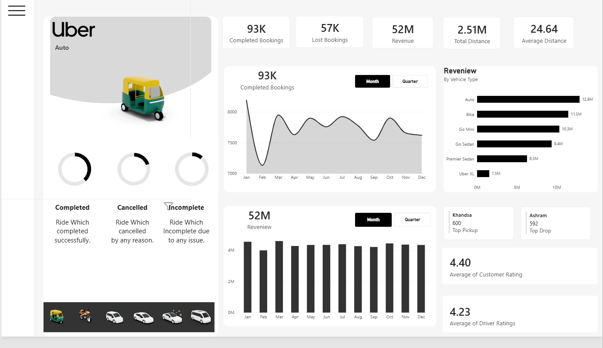

# 🚖 Uber Ride Analysis Dashboard (Power BI)

An interactive Power BI dashboard analysing Uber bookings: completed vs lost rides, revenue by vehicle type, monthly trends, top pickup and drop locations, and customer and driver ratings.

## 🎯 Objective
To understand which vehicle segments earn the most, how bookings and revenue move through the year, where demand is concentrated, and how many rides are lost.

## 🗂️ Dataset
- **Source:** [Uber Data]
- **Size:** [150000] rows × [20] columns
- **Key fields:** booking status, vehicle type, booking value, distance, pickup and drop location, date, customer and driver ratings

## 🛠️ Tools Used
Power BI (data modelling, DAX measures, interactive visuals)

## 📊 Dashboard Features
- KPI cards: completed bookings, lost bookings, revenue, total distance, average distance
- Booking status breakdown: completed, cancelled and incomplete rides
- Monthly and quarterly trend of completed bookings and revenue
- Revenue by vehicle type
- Top pickup and top drop locations
- Average customer and driver ratings
- Vehicle selector to filter the whole page

## 📈 Key Insights
- The business recorded **93K completed bookings** and **57K lost bookings**, so roughly **62% of bookings were completed and 38% were lost**.
- Total revenue was about **52M**, with a total distance of **2.51M** and an average distance of **24.64** per ride.
- **Auto was the top revenue segment at 12.9M (about 25% of total)**, followed by **Bike (11.5M)** and **Go Mini (10.3M)**. These three segments together brought in about two-thirds of revenue.
- **Uber XL was the weakest segment at 1.5M (about 3%)**, and Premier Sedan was second lowest at 6.3M.
- Monthly **revenue stays steady at roughly 4M** through the year, with February the lowest month.
- Completed bookings **fluctuate between about 7,100 and 8,300 per month**, with the biggest dip in February and recoveries in March and October.
- **Khandsa** was the top pickup location (600 rides) and **Ashram** the top drop location (592 rides).
- Customers rated their rides **4.40** on average versus **4.23** for drivers.


## 🖼️ Dashboard Preview


## 📁 Repository Structure
```
uber-revenue-analysis-powerbi/
├── data/       # Dataset
├── images/     # Dashboard screenshots
├── powerbi/    # Power BI file (.pbix)
└── README.md
```

## ▶️ How to Open
Download the `.pbix` file from the `powerbi` folder and open it with **Power BI Desktop** (free from Microsoft).

## 👤 Author
**Sidharth R**
[LinkedIn](https://www.linkedin.com/in/sidharth-r-943115233) · [GitHub](https://github.com/sidharthram99) · ✉️ sidharthram99@gmail.com
